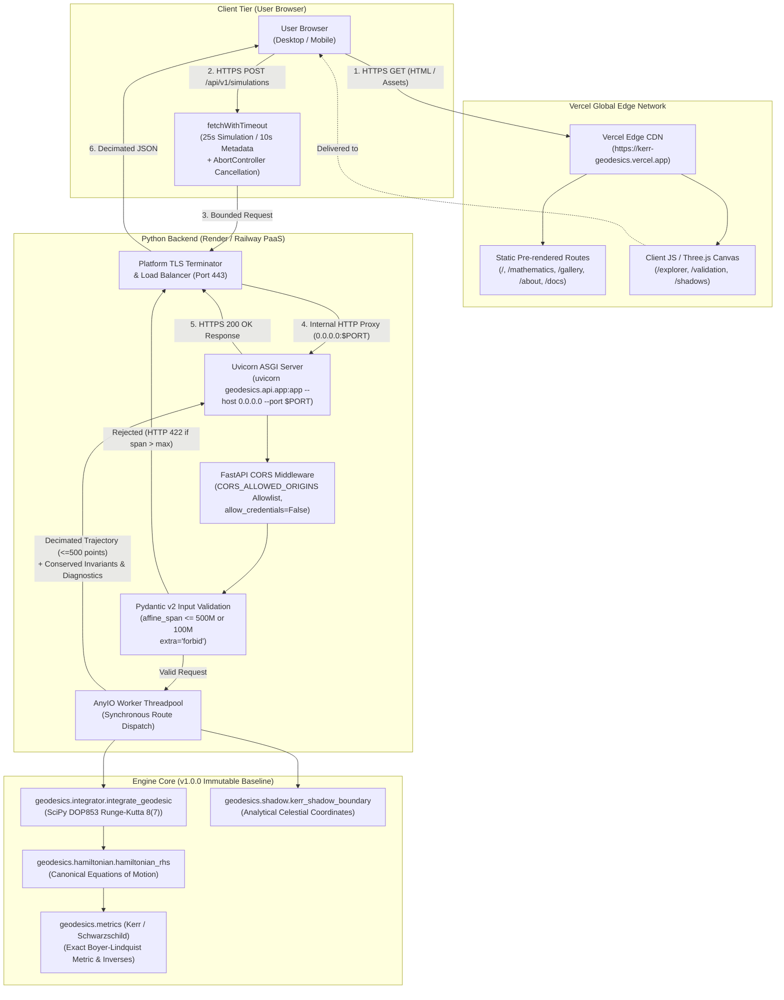

# Kerr Geodesics Lab — Stage 3: Deployment Architecture, Readiness Assessment & Safeguards

**Document ID:** `docs/lab/stage_3_deployment_architecture_and_readiness.md`  
**Revision:** Stage 3.2 Deployment Safeguards Implementation  
**Date:** 2026-11-19  
**Role:** Deployment Architect & Implementation Agent  
**Branch Baseline:** `feat/kerr-geodesics-lab` (`6ec673f3c3621437dcbbc1078a432b7598b141da`)  
**Engine Release Baseline:** `v1.0.0` (`062b20c80a689640637a2fcd003bdd921a7d4132`)  
**Status:** Safeguards Implemented and Verified — Ready for Independent Scientific Review
**Hosting Target:** \$0/month (Render Free + Vercel Hobby)

---

## 1. Executive Summary & Architecture Options

The Kerr Geodesics Lab application comprises two decoupled components:
1. **Frontend:** A Next.js 16.4.6 / React 19 web application employing the App Router, static site generation, and client-side reactive Canvas / Three.js visualizers.
2. **Backend:** A stateless FastAPI / Uvicorn scientific API adapter delegating all orbital integration and shadow boundary calculations strictly to the immutable `v1.0.0` Kerr Geodesic Integrator engine (`scipy` / `numpy`).

To accommodate different operational goals and licensing constraints, two distinct deployment paths are evaluated:

### Choice A: $0/month Public Demonstration (Selected Configuration)
* **Frontend:** **Vercel Hobby ($0/month)** — *Eligible strictly for personal, non-commercial use.*
* **Backend:** **Render Free Web Service ($0/month)** — *512 MB RAM, 0.1 vCPU, 750 free instance hours/month.*
* **Operational Reality:** Free web services on Render automatically spin down after 15 minutes of inactivity. When a new user arrives, the initial request triggers a container cold start taking **approximately one minute (30–60 seconds)** before presets load. This tier is suitable only for zero-budget personal demonstrations where cold-start latency is acceptable.
* **Cost Risk:** If the workspace exhausts 750 free instance hours in a calendar month, Render suspends the service until the next billing cycle. No charges are incurred; the service simply becomes unavailable.

### Choice B: Reliable Always-On Public Deployment ($5.00 – $7.00 / month)
* **Frontend:** **Vercel Hobby ($0/month)** (or **Vercel Pro at $20/month** if commercial).
* **Backend:** **Render Starter ($7/month flat)** or **Railway Hobby ($5/month minimum base)**. *(Not selected for this deployment.)*
* **Operational Reality:** Eliminates sleeping containers and cold starts. The backend container remains resident in memory 24/7, providing instant sub-second responses for simulation presets, parameter adjustments, and shadow boundary computations.

---

## 2. Verified Hosting Options Comparison

*All provider terms, limits, and pricing documented below were verified against official platform documentation on **2026-11-19**.*

### 2.1 Frontend Hosting Evaluation

| Evaluation Criteria | Vercel (Recommended) | Cloudflare Pages (Alternative) |
| :--- | :--- | :--- |
| **Pricing / Plan Tier** | **Hobby ($0/month)**<br>*Source:* [Vercel Plans](https://vercel.com/docs/plans/hobby), [Vercel Terms](https://vercel.com/legal/terms) (Accessed 2026-11-19) | **Free ($0/month)**<br>*Source:* [Cloudflare Pages Pricing](https://developers.cloudflare.com/pages/platform/pricing/) (Accessed 2026-11-19) |
| **Commercial Scope** | **Strictly Personal / Non-Commercial:** Commercial projects must upgrade to Vercel Pro ($20/seat/month). | **Personal & Commercial:** Free tier allows commercial projects subject to usage caps. |
| **Next.js 16 Compatibility** | **100% Native:** Full support for Next.js 16.4.6, React 19, Turbopack, App Router, and static asset optimization. | **Requires Adapter:** Requires `@cloudflare/next-on-pages` or OpenNext; occasional edge runtime shim friction with Node.js APIs. |
| **Edge & CDN Performance** | Global Anycast edge network with automatic cache headers (`s-maxage=31536000`, `x-nextjs-cache: HIT`). | Global Anycast CDN with fast static asset distribution. |
| **Build-Time Inlining** | `NEXT_PUBLIC_API_BASE_URL` is inlined into the client bundle at build time. Changing the backend URL requires a redeploy.<br>*Source:* [Next.js Environment Variables](https://vercel.com/docs/frameworks/nextjs/environment-variables) | Similar build-time inlining behavior for client environment variables. |
| **Custom Domains & SSL** | Custom domains included with automated Let's Encrypt SSL certificates. | Custom domains included with automated Cloudflare SSL certificates. |

---

### 2.2 Backend Hosting Evaluation (Python / FastAPI / SciPy)

| Evaluation Criteria | Render Free Tier | Render Starter Tier | Railway Hobby Plan |
| :--- | :--- | :--- | :--- |
| **Monthly Cost** | **$0.00 / month** | **$7.00 / month** (flat rate) | **$5.00 / month** base fee (minimum) |
| **Billing Model** | Free tier with 750 free instance hours/month across workspace. | Flat monthly subscription per instance. | Subscription + metered usage. Includes $5 usage credit; overages billed per second. |
| **Documentation Reference** | [Render Free Docs](https://render.com/docs/free)<br>(Accessed 2026-11-19) | [Render Pricing](https://render.com/pricing)<br>(Accessed 2026-11-19) | [Railway Pricing](https://docs.railway.com/pricing), [Railway Free Plan](https://docs.railway.com/pricing/free-plan)<br>(Accessed 2026-11-19) |
| **Compute & Memory Specs** | 512 MB RAM, 0.1 vCPU | 512 MB RAM, 0.5 vCPU | 0.5 GB–48 GB RAM, 1–48 vCPUs (shared allocation) |
| **Sleep / Inactivity Behavior** | **Spins down after 15 min** of zero inbound traffic. | **Always on.** Zero inactivity spin-downs. | **Always on** on Hobby (unless manually configured to sleep). Free plan sleeps when idle. |
| **Cold Start Latency** | **~30 to 60+ seconds** to boot container and load Python/SciPy. | **Zero cold start.** Resident in memory. | **Zero cold start** for always-on service. |
| **Cost Predictability** | Guaranteed $0 (service suspends if 750 monthly hours expire). | Guaranteed fixed $7/month; no surprise overages. | **Variable:** Base $5 credit covers low traffic; heavy traffic or memory overages incur extra charges. |
| **Custom Domains & HTTPS** | Included with managed SSL. | Included with managed SSL. | Included with managed SSL on $5 Hobby tier (not on free tier). |
| **Port & Host Binding** | Dynamic `$PORT`. Requires `uvicorn --host 0.0.0.0 --port $PORT`. | Dynamic `$PORT`. Requires `uvicorn --host 0.0.0.0 --port $PORT`. | Dynamic `$PORT`. Requires `uvicorn --host 0.0.0.0 --port $PORT`. |

---

## 3. Recommended Architecture Diagram



---

## 4. Implemented Deployment Safeguards (Stage 3.2 & Stage 3.2.1)

In Stages 3.2 and 3.2.1, concrete operational safeguards and configuration requirements were implemented in the API and frontend client layers without modifying the core physics engine:

### 4.1 Workload Bounding: Defensible `affine_span` Operational Safeguards
* **File:** `src/geodesics/api/schemas.py`
* **Mechanism:** Bounded Pydantic v2 `Field(..., gt=0, le=MAX_SPAN)` constraints on all seven preset models.
* **Preservation of Defaults:** All seven preset default spans remain completely intact:
  - `schwarzschild_isco_circular`: Default `50.0` (Bound: `le=500.0`)
  - `schwarzschild_precession`: Default `100.0` (Bound: `le=500.0`)
  - `schwarzschild_photon_sphere`: Default `12.0` (Bound: `le=100.0`)
  - `kerr_equatorial_prograde_photon`: Default `20.0` (Bound: `le=100.0`)
  - `kerr_equatorial_retrograde_photon`: Default `30.0` (Bound: `le=100.0`)
  - `kerr_circular_timelike`: Default `100.0` (Bound: `le=500.0`)
  - `kerr_equatorial_scattering`: Default `200.0` (Bound: `le=500.0`)

#### Rigorous Affine-Parameter Orbital Mechanics
Units and conventions: Geometrized units $G = c = 1$, central black hole mass $M > 0$, metric signature $(-, +, +, +)$, Boyer–Lindquist coordinates $(t, r, \theta, \phi)$. The canonical Hamiltonian is $\mathcal{H} = \frac{1}{2} g^{\mu\nu} p_\mu p_\nu = -\frac{1}{2}\mu^2$, with $\mu = 1$ for timelike geodesics (where affine parameter $\lambda$ equals proper time $\tau$) and $\mu = 0$ for null geodesics.

Hamilton's equation of motion for azimuthal coordinate $\phi$ in the equatorial plane ($\theta = \pi/2$, $p_\theta = 0$) gives the **affine-parameter angular frequency**:
$$\frac{d\phi}{d\lambda} = \frac{\partial \mathcal{H}}{\partial p_\phi} = g^{\phi\phi} p_\phi = \frac{L_z}{r^2}$$
For a Schwarzschild circular timelike orbit ($a=0$), the specific angular momentum at radius $r$ satisfies:
$$L_z = \frac{\sqrt{Mr}}{\sqrt{1 - 3M/r}}$$
At the Innermost Stable Circular Orbit (ISCO, $r = 6M$):
$$L_z = \frac{\sqrt{6M^2}}{\sqrt{1 - 1/2}} = 2\sqrt{3}M$$
Therefore, the exact affine angular frequency is:
$$\left.\frac{d\phi}{d\lambda}\right|_{r=6M} = \frac{2\sqrt{3}M}{(6M)^2} = \frac{1}{6\sqrt{3}M} \approx 0.096225\text{ rad / (unit affine parameter)}$$
The affine-parameter orbital period for one complete $2\pi$ revolution is:
$$\Delta \lambda_{\text{orbit}} = \frac{2\pi}{d\phi/d\lambda} = 12\sqrt{3}\pi M \approx 65.296 M$$
*(In contrast, the coordinate-time orbital frequency is $\Omega = \frac{d\phi}{dt} = \frac{d\phi/d\lambda}{dt/d\lambda} = \frac{1}{6\sqrt{6}M} \approx 0.06804$, yielding coordinate-time period $\Delta t_{\text{orbit}} = 12\sqrt{6}\pi M \approx 92.345 M$).*

Consequently:
- At default `affine_span = 50.0`: The particle completes $\frac{50.0}{12\sqrt{3}\pi} \approx 0.766$ of a circular orbit ($\approx 275.6^\circ$).
- At upper bound `affine_span = 500.0`: The particle completes $\frac{500.0}{12\sqrt{3}\pi} \approx 7.657$ complete circular orbits ($\approx 2756.7^\circ$).

#### Unstable Circular Photon Orbits & Lyapunov Instability
Circular photon orbits ($r = 3M$ in Schwarzschild, $r_{\text{ph}}^\pm$ in Kerr) are dynamically unstable saddle points ($V_{\text{eff}}''(r_{\text{ph}}) < 0$). Under finite floating-point precision ($10^{-16}$) and numerical step truncation, trajectories depart along unstable manifolds. The affine departure parameter $\lambda_{\text{depart}}$ is **not a universal constant**, but depends sensitively on initial perturbations, spacetime spin $a$, solver tolerances (`rtol`, `atol`), and machine roundoff. The upper bound of `MAX_UNSTABLE_PHOTON_AFFINE_SPAN = 100.0` is an operational safeguard: it provides ample range to observe the circular phase and divergence while preventing indefinite integration of uninformative asymptotic rays.

#### Empirical Preset Benchmark Evidence
A reproducible benchmark across all 14 preset configurations was executed on Intel64 Windows 11 (Python 3.13.5, NumPy 2.1.2, SciPy 1.16.0, DOP853 solver, 3 repeats per configuration):

| Preset ID | Requested $\lambda$ | Achieved $\lambda$ | Raw Accepted Steps | RHS Evaluations (`nfev`) | Decimated Points | Early Termination Event | Wall-Clock Time (ms) |
| :--- | :---: | :---: | :---: | :---: | :---: | :---: | :---: |
| `schwarzschild_isco_circular` | 50.0 | 50.000 | 103 | 1,532 | 103 | None | $104.4 \pm 26.9$ ms |
| `schwarzschild_isco_circular` | 500.0 | 500.000 | 1,003 | 15,032 | 499 | None | $2,838 \pm 110$ ms |
| `schwarzschild_precession` | 100.0 | 100.000 | 203 | 3,032 | 204 | None | $555.7 \pm 49.6$ ms |
| `schwarzschild_precession` | 500.0 | 500.000 | 1,003 | 15,032 | 500 | None | $2,797 \pm 250$ ms |
| `schwarzschild_photon_sphere` | 12.0 | 12.000 | 27 | 392 | 27 | None | $65.4 \pm 1.1$ ms |
| `schwarzschild_photon_sphere` | 100.0 | 100.000 | 203 | 3,032 | 203 | None | $539.4 \pm 36.4$ ms |
| `kerr_equatorial_prograde_photon` | 20.0 | 20.000 | 43 | 632 | 44 | None | $247.6 \pm 43.0$ ms |
| `kerr_equatorial_prograde_photon` | 100.0 | 29.821 | 100 | 2,027 | 101 | **`horizon_cutoff`** ($\lambda \approx 29.82$) | $572.4 \pm 38.2$ ms |
| `kerr_equatorial_retrograde_photon` | 30.0 | 30.000 | 63 | 932 | 63 | None | $272.3 \pm 5.2$ ms |
| `kerr_equatorial_retrograde_photon` | 100.0 | 100.000 | 203 | 3,032 | 203 | None | $881.6 \pm 35.2$ ms |
| `kerr_circular_timelike` | 100.0 | 100.000 | 203 | 3,032 | 204 | None | $916.1 \pm 29.5$ ms |
| `kerr_circular_timelike` | 500.0 | 500.000 | 1,003 | 15,032 | 499 | None | $4,708 \pm 161$ ms |
| `kerr_equatorial_scattering` | 200.0 | 102.091 | 207 | 3,092 | 208 | **`escape_radius`** ($\lambda \approx 102.09$) | $922.0 \pm 22.2$ ms |
| `kerr_equatorial_scattering` | 500.0 | 102.091 | 207 | 3,092 | 208 | **`escape_radius`** ($\lambda \approx 102.09$) | $956.9 \pm 34.1$ ms |

*Solver Diagnostics & Evaluation Counts:*
In adaptive explicit Runge-Kutta integration (`DOP853`), it is essential to distinguish **accepted integration steps** from **total right-hand side evaluations (`nfev`)**:
- An accepted step is a successful progress increment in affine parameter along the trajectory grid. Because the API preset runner enforces `max_step = 0.5`, the solver cannot advance by more than $0.5$ in affine parameter per step, setting a lower bound on accepted steps of approximately $2 \times \Delta\lambda$.
- Right-hand side evaluations (`nfev`) represent every call to the Hamiltonian vector field equations. DOP853 utilizes an 8th-order explicit scheme requiring 12 stages per step, plus additional stages for 7th/5th-order error estimation, dense output continuous interpolants (which add stages when dense output or continuous event monitoring is active), step rejection retries, and iterative root-finding for event triggers.
- Consequently, there is no universal constant multiplier between accepted steps and `nfev`. In the benchmark measurements across smooth, non-stiff configurations without step rejections, `nfev` was observed to scale consistently with the combination of core solver stages and event monitoring evaluations (e.g. 103 accepted steps yielded 1,532 `nfev` for ISCO at span 50; 1,003 accepted steps yielded 15,032 `nfev` at span 500). When trajectories encounter strong field gradients or horizon buffers, local step sizes shrink and event root-finding occurs (e.g. prograde photon orbit terminating at $\lambda \approx 29.82$ with 100 steps and 2,027 `nfev`).

#### Qualification and Scope of Safeguard Limits
The affine-span limits (`100.0` for unstable photon orbits and `500.0` for timelike and scattering orbits) are **tested operational API caps**, designed to maintain interactive responsiveness and prevent indefinite resource consumption:
- **Benchmark Scope & Limitations:** The empirical benchmark measurements reported above cover the specific representative configurations tested. They do **not** cover every possible permutation of initial radii, momenta perturbations, energy values, or extremal spin parameters.
- **Operational Nature:** These limits are **not proven worst-case runtime bounds** across arbitrary spacetimes or pathological stiff parameter regimes, nor are they universal physical cutoffs. They represent empirical operational safeguards calibrated under typical preset usage.
- **Specific Preset Evaluations:**
  - *Timelike Orbits (`500.0` cap):* For the tested configurations (`schwarzschild_isco_circular`, `schwarzschild_precession`, `kerr_circular_timelike`), this cap allowed between $104\text{ ms}$ and $4.71\text{ s}$ of local CPU execution while providing over $7.6$ complete revolutions for ISCO orbits.
  - *Unstable Circular Photon Orbits (`100.0` cap):* For the tested equatorial photon configurations, departure occurred within the integrated interval (with prograde at $a=0.9$ terminating at the horizon cutoff at $\lambda \approx 29.82$). Execution remained below $0.9\text{ s}$ on the benchmark system.
  - *Scattering Encounters (`500.0` cap):* For the tested $b=4.5, r_0=50M$ configuration, integration terminated at the escape boundary ($r = 100M$) at $\lambda \approx 102.09$ in under $1.0\text{ s}$. The 500.0 cap permits near-critical trajectories with multiple orbital windings while preventing open-ended runaway calculation.

### 4.2 Frontend Request Timeout & Error Classification Semantics
* **Files:** `frontend/src/lib/api.ts`, `frontend/src/app/explorer/page.tsx`
* **Mechanism:** `fetchWithTimeout` wrapper combining an internal `AbortController`, `setTimeout`, and caller-supplied `AbortSignal`.
* **Timeout Values:**
  - `DEFAULT_SIMULATION_TIMEOUT_MS = 25000` (25 seconds for numerical ODE integration)
  - `DEFAULT_METADATA_TIMEOUT_MS = 10000` (10 seconds for `/health` and `/presets`)
* **Accurate Timeout Semantics & Operational Boundaries:**
  1. *Frontend Responsiveness Limit, Not Backend Thread-Kill:* The 25-second timeout is strictly a **client-side failure-reporting and UI unblocking limit**. In standard HTTP and ASGI architectures, aborting a browser `fetch` closes the client connection, but does **not** terminate an already-executing synchronous Python worker thread. The worker thread will continue running until ODE termination or event cutoff.
  2. *Direct Browser-to-Backend Topology:* In standard CORS deployment, the browser client calls the backend directly via HTTPS (`https://api.onrender.com`); it does **not** traverse Vercel's serverless gateway. The 25-second limit was chosen as an interactive usability threshold (allowing container cold starts plus max-span calculations) well before PaaS reverse-proxy timeouts (e.g. Render's 100-second timeout).
  3. *Distinction of Timeout vs Cancellation:*
     - Client timeout produces `errorType: "timeout_error"`, `statusCode: 408`, `isTimeout: true`, `isAborted: false`.
     - User cancellation (parameter adjustments / preset switches) produces `errorType: "abort_error"`, `statusCode: 499`, `isTimeout: false`, `isAborted: true`.
  4. *No Backend Concurrency Limit:* The backend currently has **no separate concurrency limit or thread-killing mechanism**. Concurrency protection relies entirely on the workload bounding (`affine_span` upper bounds) preventing long-running thread monopolization.

### 4.3 Fail-Closed Production CORS Configuration
* **File:** `src/geodesics/api/app.py`
* **Mechanism:** Dedicated `parse_cors_origins(raw, environment)` reading `CORS_ALLOWED_ORIGINS` and `ENVIRONMENT` (or `APP_ENV`).
* **Rules & Constraints:**
  1. **Fail-Closed in Production:** In production mode (`ENVIRONMENT='production'` or `APP_ENV='production'`), an explicit, nonempty `CORS_ALLOWED_ORIGINS` is **strictly required**. If absent, empty, or whitespace-only, application startup aborts immediately with a `RuntimeError` before binding the port or serving requests.
  2. **Development Defaults:** In development mode (`ENVIRONMENT='development'` or unset), omitting `CORS_ALLOWED_ORIGINS` safely falls back to `DEFAULT_DEV_ORIGINS` (`localhost:3000`, `127.0.0.1:3000`, `localhost:3001`, `127.0.0.1:3001`).
  3. **Wildcard Prohibition:** Wildcard `*` is strictly prohibited in all modes and raises a `ValueError`.
  4. **Credentials Security:** `allow_credentials=False` is strictly maintained. The API is entirely stateless (no session cookies, HTTP authorization headers, or private user credentials).
  5. **Preflight Support:** HTTP `OPTIONS` preflight requests are fully supported for allowed origins with methods `GET, POST, OPTIONS` and headers `Content-Type, Accept, Authorization`.

---

## 5. Deployment Configuration & Environment Variables

### 5.1 Environment Variables Matrix

| Variable Name | Component | Required In | Format / Example | Purpose |
| :--- | :---: | :---: | :--- | :--- |
| `ENVIRONMENT` | Backend | Production | `production` (or `development`) | Runtime environment mode. In `production`, enforces strict fail-closed CORS. |
| `CORS_ALLOWED_ORIGINS` | Backend | Production | `https://kerr-geodesics.vercel.app` (or comma-separated domains) | Allowlist of public frontend domains permitted to make cross-origin API requests. Strictly rejects `*`. |
| `PYTHON_VERSION` | Backend | Production | `3.13.5` | Pins Python runtime version on Render (aligned with tested environment). |
| `PORT` | Backend | Production | Injected automatically by Render (e.g. `10000` or `8080`) | Dynamic port to bind Uvicorn server (`0.0.0.0:$PORT`). |
| `NEXT_PUBLIC_API_BASE_URL` | Frontend | Build-time (Vercel) | `https://kerr-api.onrender.com` | Base URL of the live FastAPI backend inlined into client JavaScript bundles at build time. |

### 5.2 Render Web Service Configuration (Backend)
- **Service Type:** Web Service (free tier — spins down after 15 minutes of inactivity)
- **Plan:** Free ($0/mo; 512 MB RAM, 0.1 vCPU; 750 free instance hours/month per workspace)
- **Cold-Start Behavior:** After 15 minutes of zero inbound traffic, Render shuts down the container. The next inbound request triggers a cold start of approximately 30–60 seconds while the container boots and loads the Python/SciPy stack. The frontend 25-second simulation timeout will expire during a cold start; the user will see a timeout/network error on first request. The second request (after warm-up) succeeds normally.
- **No Persistent Filesystem:** The free tier provides no persistent disk. The API is fully stateless and requires no disk storage.
- **Runtime:** Python 3.13.5 (matches tested environment)
- **Build Command:** `pip install --upgrade pip && pip install ".[api]"`
- **Start Command:** `uvicorn geodesics.api.app:app --host 0.0.0.0 --port $PORT`
- **Health Check Path:** `/health`
- **Auto-Deploy & Branch Linking:** Render auto-deploys from git branches (not tags). `branch: master` is specified in `render.yaml`, and auto-deploy is explicitly disabled (`autoDeployTrigger: "off"`) pending manual authorization.
- **Blueprint Specification:** Provided in repository root [`render.yaml`](../../render.yaml) with `sync: false` for `CORS_ALLOWED_ORIGINS` to prevent hardcoding future domains in git.
- **Blueprint Schema Provenance:** Validated locally via [`scripts/validate_blueprint.py`](../../scripts/validate_blueprint.py) against a bundled copy of the official Render Blueprint JSON Schema ([`render_schema.json`](../../render_schema.json), untracked local cache retrieved from `https://render.com/schema/render.yaml.json` on `2026-11-25`). JSON Schema validation confirms structural and enum conformance only; it does not prove cloud service provisioning or live deployment success.

### 5.3 Vercel Project Configuration (Frontend)
- **Framework Preset:** Next.js (automatically detected)
- **Root Directory:** `frontend`
- **Build Command:** `npm run build` (or `next build`)
- **Output Directory:** `.next`
- **Install Command:** `npm install`
- **Build-Time Environment Variable:** `NEXT_PUBLIC_API_BASE_URL` set to the live HTTPS URL of the deployed Render backend.
- **Preview Deployment CORS Policy:** In production, `CORS_ALLOWED_ORIGINS` explicitly enumerates the production domain(s). Arbitrary dynamic preview URLs (e.g. `*.vercel.app`) are strictly rejected by the backend to prevent cross-origin abuse. If a dedicated staging frontend is tested, its exact fixed origin must be explicitly added to `CORS_ALLOWED_ORIGINS`.

---

## 6. Pre-Deployment & Post-Deployment Verification

### 6.1 Pre-Deployment Sequencing
1. **Commercial Eligibility:** Verify that the project scope qualifies as personal/non-commercial under Vercel Hobby terms.
2. **Backend Deployed First:** Provision the Render Web Service and determine its assigned live HTTPS URL (e.g. `https://kerr-api.onrender.com`).
3. **Frontend Domain Allocated:** Note the planned Vercel domain (e.g. `https://kerr-geodesics.vercel.app`) and configure it in Render's `CORS_ALLOWED_ORIGINS`.
4. **Frontend Built with Inlined API Target:** Set `NEXT_PUBLIC_API_BASE_URL=https://kerr-api.onrender.com` in Vercel project settings and trigger the production build.

### 6.2 Post-Deployment Automated Smoke-Test Plan
A standalone, zero-dependency smoke test script is provided in `scripts/smoke_test_deployment.py`:

```bash
# Run against live production deployment
python scripts/smoke_test_deployment.py \
  --api-url https://kerr-api.onrender.com \
  --frontend-url https://kerr-geodesics.vercel.app
```

The smoke-test suite automates up to **16 HTTP checks** (8 backend + CORS checks when `--frontend-url` is omitted, with checks 9–16 marked `[SKIP]`; all 16 checks when `--frontend-url` is provided):
1. `GET /health` returns HTTP 200, `status="ok"`, and matches engine release commit `062b20c80a689640637a2fcd003bdd921a7d4132`.
2. `GET /api/v1/presets` returns all 7 presets.
3. `POST /api/v1/simulations` with Schwarzschild ISCO parameters succeeds.
4. `POST /api/v1/simulations` with Kerr timelike parameters succeeds.
5. `POST /api/v1/shadows` returns analytical Kerr shadow coordinates.
6. `POST /api/v1/simulations` with out-of-bounds `affine_span=9999.0` returns HTTP 422 (`invalid_request_parameters`).
7. `OPTIONS /api/v1/simulations` preflight (`Origin`, `Access-Control-Request-Method: POST`, `Access-Control-Request-Headers: content-type`) for the approved origin returns HTTP 200 with matching `access-control-allow-origin`, `POST` in `access-control-allow-methods`, and `content-type` in `access-control-allow-headers`.
8. `OPTIONS /api/v1/simulations` preflight for an unauthorized origin omits `access-control-allow-origin`.
9–16. Frontend `GET` requests return HTTP 200 across all 8 primary application routes (`/`, `/about`, `/docs`, `/explorer`, `/gallery`, `/mathematics`, `/shadows`, `/validation`) when `--frontend-url` is supplied.

#### Manual Browser Verification (Post-Deployment)
After the automated smoke-test script passes, perform manual browser checks on the live site:
1. Interactive Explorer renders trajectories against the production backend.
2. Error classification banners display properly on client timeouts or network unreachable states.

---

## 7. Remaining Operational Limitations

1. **CPU Contention under High Concurrency:**  
   Because Python evaluates the geodesic equations of motion (`hamiltonian_rhs`) during Runge-Kutta stepping, the Python Global Interpreter Lock (GIL) is partially acquired during integration. Multiple concurrent simulation requests on a fractional-vCPU instance (Render Free/Starter) will contend for CPU, increasing per-request response times.
2. **Stateless Execution:**  
   The API has zero database or disk persistence. Every simulation request is integrated fresh in memory. Decimated trajectories are returned directly to the client without server-side caching.
3. **Cold Starts on Render Free Tier:**
   On Render Free tier, containers spin down after 15 minutes of inactivity, causing a 30–60 second cold start. The frontend 25-second timeout will expire on first contact after a sleep period; the user receives a timeout error. The backend warms up in the background and the second request succeeds normally. This is an expected and documented limitation of the $0 free-tier deployment. Users should be advised of potential first-request latency.

---

## 8. Resolution of CORS Verification Command Exit Code

In prior activity logs, a bare shell one-liner testing production fail-closed behavior exited with code 1:
```bash
python -c "from geodesics.api.app import parse_cors_origins; parse_cors_origins(None, environment='production')"
```
- **Investigation:** In Python, an uncaught exception (`RuntimeError`) causes the interpreter to terminate and exit with code 1. The one-liner did not wrap the call in a `try...except` block.
- **Verification:** When executed within a controlled harness that catches `RuntimeError`, the command exits with code 0:
  ```bash
  python -c "import sys; from geodesics.api.app import parse_cors_origins;
  try:
      parse_cors_origins(None, environment='production')
      sys.exit(1)
  except RuntimeError:
      print('PASS: Caught expected RuntimeError')
      sys.exit(0)"
  ```
  This proves the fail-closed behavior was functioning exactly as intended and that the non-zero exit code resulted entirely from an unhandled exception in the shell invocation.

---

## 9. Deployment Readiness Verdict

**Overall Status:** `CONDITIONAL PASS`

All application source code, API schemas, integration safeguards, configuration blueprints, and smoke test suites have been fully prepared and locally verified. However, production readiness cannot be certified as an unconditional `PASS` or "zero technical blockers" prior to actual cloud resource provisioning and DNS propagation.

### Explicit Deployment Conditions:
1. **Branch Merge & Release Promotion:**
   The working feature branch `feat/kerr-geodesics-lab` must be approved and merged into `main`. The underlying `v1.0.0` physics engine release remains strictly pinned to `062b20c80a689640637a2fcd003bdd921a7d4132`.
2. **Backend Service Creation on Render:**
   The Web Service must be provisioned via `render.yaml` Blueprint or dashboard linking `branch: master`, selecting `plan: free` ($0/mo; 512 MB RAM, 0.1 vCPU), and setting `PYTHON_VERSION=3.13.5`. The free tier spins down after 15 minutes of inactivity.
3. **CORS Origin Configuration:**
   Because production CORS fails closed when `CORS_ALLOWED_ORIGINS` is missing or empty, the exact production Vercel domain(s) must be manually populated in Render environment settings before serving client traffic.
4. **Vercel Build-Time Environment Variable Inlining:**
   `NEXT_PUBLIC_API_BASE_URL` must be set in Vercel project settings to the live Render HTTPS URL before triggering the Vercel production build, ensuring client JavaScript bundles contain the correct backend target.
5. **Post-Deployment Smoke Verification:**
   `scripts/smoke_test_deployment.py` must be executed against the live endpoints (`--api-url` and `--frontend-url`) to confirm that all 16 automated HTTP checks (backend provenance, presets, simulations, shadows, bounds, CORS preflight, and all 8 frontend routes) pass with zero errors, followed by manual browser verification of interactive Explorer rendering and error banners.

---

*Report revised in compliance with Kerr Geodesics Lab scientific release protocols.*  
*Artifact updated: `docs/lab/stage_3_deployment_architecture_and_readiness.md`*
